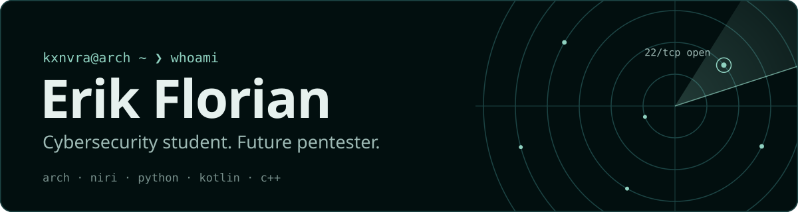

<picture>
  <source media="(prefers-color-scheme: dark)" srcset="assets/banner-dark.svg">
  <source media="(prefers-color-scheme: light)" srcset="assets/banner-light.svg">
  
</picture>

I study cybersecurity and I want to be a pentester. It started when I was eleven, taking printers and old computers apart for parts. Python was my first code, and three distros later I ended up on Arch with niri and my own configs.

Our team won the school CTF. I've also been to a summer cyber camp, hackdays, techdays and, in October 2026, an AI hackathon.

### Things I've built

- **[mupc-cc](https://github.com/ErikFlorian/mupc-cc)**: a compiler and assembler for a C-like language that targets the MuPC hobby 8-bit CPU. C++17.
- **[Kecheenok](https://github.com/ErikFlorian/Video-downloader-Kecheenok)**: a desktop video and audio downloader with a queue, history and a small media studio. Python.
- **[Hyprland-Niri-dots](https://github.com/ErikFlorian/Hyprland-Niri-dots)**: my Arch desktop as a one-command installer, with niri or Hyprland and the Noctalia shell.
- **Pulsar**: an Android music player in Kotlin, built on Retro Music, with a download server on my VPS. People already use it, even though it isn't finished. Private for now.
- **[Macspoofer](https://github.com/ErikFlorian/Macspoofer)**: a small MAC address spoofer in Python.
- **Websites**: [serpvote](https://erikflorian.github.io/serpvote/), a voting page, and [drivelab-redesign](https://erikflorian.github.io/drivelab-redesign/), a redesign of a car service website.

### Homelab

A VPS for my services, an old ThinkPad running Debian as a home server, Pi-hole blocking ads and phishing at home, and a Pwnagotchi on a Raspberry Pi Zero that I manage over SSH.

### Tools

<picture>
  <source media="(prefers-color-scheme: dark)" srcset="https://skillicons.dev/icons?i=python,kotlin,cpp,java,js,html,css,lua,bash,linux,arch,raspberrypi,androidstudio,git&theme=dark">
  <source media="(prefers-color-scheme: light)" srcset="https://skillicons.dev/icons?i=python,kotlin,cpp,java,js,html,css,lua,bash,linux,arch,raspberrypi,androidstudio,git&theme=light">
  
</picture>

---

[erik-florian.loan](https://erik-florian.loan) · [TryHackMe](https://tryhackme.com/p/erikrouter30)
